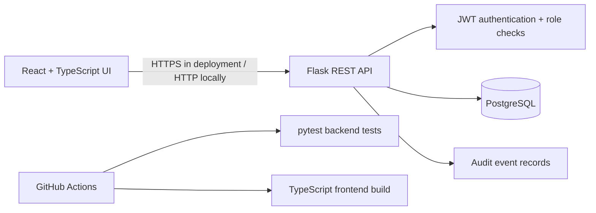

# Architecture and request flows

## Component diagram

## Main workflows

1. A user registers. The API validates the email and password, hashes the password with Werkzeug's scrypt implementation, creates a regular `user` account (public registration cannot set `admin`), and writes an audit event.
2. The user signs in and receives a short-lived JWT. The frontend sends it in the `Authorization: Bearer` header for authenticated requests.
3. The user submits an access request. The API validates the requested system, reason and duration, persists a pending record and records the event.
4. An administrator account is provisioned through a local/operator command rather than public signup. Only that role can access decision and audit endpoints.
5. An administrator approves or rejects a pending request. The API records the decision, reviewer and audit event; repeat decisions are rejected.

## Trust boundaries

- The browser is untrusted. The API validates all required inputs and never accepts a client-supplied role during public registration.
- Administrator operations are checked against the user record in the database, rather than trusting only a role value from the browser.
- Secrets are configuration values and must not be committed. Local defaults are for demo use only.
- The database is reachable by application services only in a production deployment; the local Compose file maps its port for development convenience.

## Known MVP limitations

This is a portfolio MVP, not a production IAM service. It does not yet include email verification, account recovery, rate limiting, refresh-token rotation, a formally append-only audit store, schema migrations, automatic expiry/revocation of grants, or a deployed AWS environment. These are documented next steps rather than claimed features.
